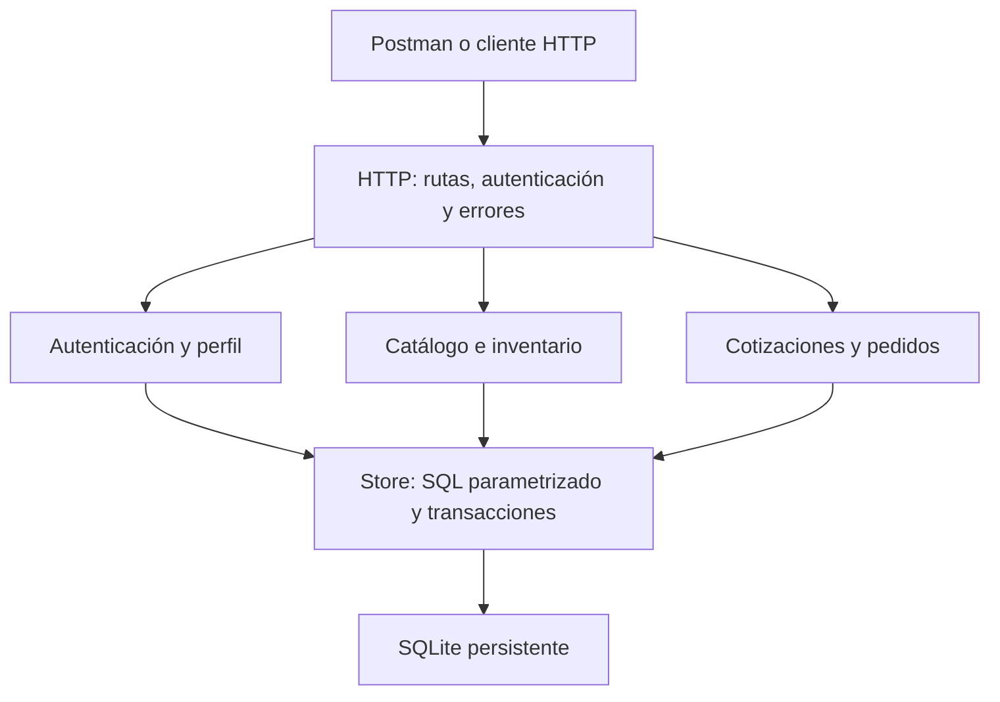
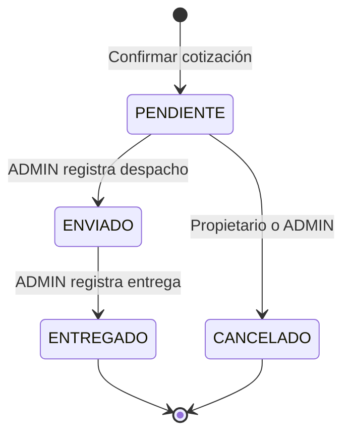

# Diseño de las API del proyecto RaízVolt

Jhon Edwards Tineo Landaeta · Ficha 3235874 · SENA · 2 de noviembre de 2026

## Introducción

RaízVolt propone comercializar soluciones solares mediante una empresa digital
en Colombia. Esta evidencia implementa servicios HTTP para los procesos básicos
del catálogo y la venta, a partir del catálogo anterior y del ejercicio de
autenticación. La entrega contiene código comentado, documentación por servicio,
pruebas reproducibles y versionamiento con Git y publicación de fuentes en GitHub.

## Objetivo general

Diseñar, codificar y documentar una API REST que permita consultar productos
solares, controlar inventario y gestionar cotizaciones y pedidos con separación
de permisos entre clientes y administradores.

## Objetivos específicos

- Definir recursos, métodos, validaciones y respuestas JSON.
- Mantener datos persistentes y proteger credenciales y operaciones privadas.
- Asegurar consistencia entre cotización, pedido e inventario.
- Proporcionar contratos y ejemplos que permitan consumir cada servicio.
- Conservar fuentes y cambios en un repositorio verificable.

## Base consultada y alcance adoptado

Se revisaron los archivos reales de AA5-EV01 (autenticación) y AA4-EV03
(contrato y trazabilidad del catálogo React/Spring Boot). La instrucción pegada
en el chat fue la fuente de requisitos de esta evidencia. No se pudo leer el
adjunto denominado IE-GA7-220501096-AA5-EV03.pdf.

Se conservan los casos HU-PR01 a HU-PR04 del catálogo. Perfil, roles, inventario
auditable, cotizaciones y pedidos son extensiones propuestas para demostrar el
flujo comercial de RaízVolt; no se presentan como historias previamente
aprobadas por el instructor. Se excluyen pagos, impuestos, flete, facturación,
conexión con proveedores chinos, logística real y gestión aduanera.

## Trazabilidad de funciones

| Requisito / origen | Servicio implementado | Criterio verificable |
|---|---|---|
| HU-PR01 · catálogo anterior | POST /api/productos | 201 al crear; código único; validación de campos. |
| HU-PR02 · catálogo anterior | GET /api/productos y /{id} | Filtros literales, paginación y detalle activo. |
| HU-PR03 · catálogo anterior | PUT /api/productos/{id} | Conserva ID; actualiza datos; stock por movimiento separado. |
| HU-PR04 · catálogo anterior | DELETE /api/productos/{id} | Retira del catálogo y preserva historia; baja lógica. |
| Caso AA5-EV01 · autenticación | POST /api/registro y /api/login | Credenciales correctas 200; incorrectas 401; contraseña con hash. |
| HU-API01 · extensión | Perfil, tokens y logout | Cliente no cambia rol; token vence/revoca; datos propios. |
| HU-API02 · extensión | Inventario y movimientos | Saldo 0-1000000; motivo obligatorio; sumas exactas. |
| HU-API03 · extensión | Cotizaciones | Precios del servidor, vigencia 7 días, sin reserva de stock. |
| HU-API04 · extensión | Pedidos | Perfil requerido; reserva atómica; repetición sin doble descuento. |
| HU-API05 · extensión | Estado del pedido | Transiciones válidas, permisos y devolución única al cancelar. |

## Arquitectura

Se usa un monolito modular. Los servicios son recursos de una misma API, no
microservicios desplegados por separado. Node.js 24.x mantiene la tecnología
del ejercicio de autenticación; SQLite permite ejecutar la evidencia sin
instalar un servidor adicional. No hay dependencias npm de terceros.

| Archivo | Responsabilidad |
|---|---|
| src/app.js | Tabla de rutas, permisos, límites HTTP, respuestas y archivos de documentación. |
| src/auth-service.js | Registro, verificación, sesiones, revocación y perfil. |
| src/catalog-service.js | Productos, ajustes, movimientos y resumen de inventario. |
| src/sales-service.js | Cotizaciones, pedidos, propiedad y transiciones. |
| src/validation.js | Tipos, campos, rangos, paginación y dinero. |
| src/database.js / schema.sql | Persistencia, restricciones, índices y transacciones. |
| src/passwords.js / rate-limit.js | Hash scrypt y límite por IP. |
| src/server.js / config.js | Arranque local, puerto, ruta de datos y cierre. |

## Modelo de datos

| Tabla | Clave y relaciones | Datos principales |
|---|---|---|
| usuarios | PK id; UNIQUE usuario | Hash, rol, perfil y fecha. |
| sesiones | PK token_hash; FK usuario_id | Hash del token y vencimiento. |
| productos | PK id; UNIQUE codigo | Categoría, precio en centavos, existencias y activo. |
| cotizaciones | PK id; FK usuario_id | Total en centavos como texto exacto, creación y vigencia. |
| cotizacion_items | PK cotizacion_id + producto_id; ambas FK | Copia de código, nombre, precio y cantidad. |
| pedidos | PK id; UNIQUE/FK cotizacion_id; FK usuario_id | Estado, total, copia JSON de envío y fechas. |
| movimientos | PK id; FK producto_id, usuario_id, pedido_id opcional | Variación, saldo, motivo y fecha. |

Relaciones: usuario 1:N sesiones, cotizaciones y pedidos; cotización 1:N líneas
y 1:0..1 pedido; producto 1:N líneas y movimientos; pedido 1:N movimientos.
La copia de precio en la línea y de dirección en el pedido es deliberada: un
cambio posterior de catálogo o perfil no modifica una operación pasada.
Las claves foráneas están activadas y se aplican restricciones CHECK/UNIQUE.

## Reglas de negocio y consistencia

- Código: 3-30 caracteres A-Z, números y guion; nombre: 3-120; cinco categorías.
- Precio: texto decimal mayor que cero, máximo 9999999999.99 COP. Se devuelve
  siempre con dos decimales. Cantidades/IDs son números enteros JSON.
- Existencias: 0-1000000. Una edición de producto no recibe stock; un ajuste
  exige variación distinta de cero y motivo de 5-200 caracteres.
- Cotización: 1-20 productos diferentes, cada cantidad 1-10000; 7 días de
  vigencia. Puede elaborarse sin stock, pero no confirmarse sin disponibilidad.
- Pedido: cotización propia, no vencida, perfil completo y todos los productos
  activos con existencias suficientes. Usa el precio que se cotizó.
- BEGIN IMMEDIATE y una única transacción agrupan pedido, reservas y movimientos.
  Si una línea falla, no queda pedido parcial ni descuento parcial de inventario.
- UNIQUE(cotizacion_id) y consulta previa hacen segura la repetición: la misma
  cotización devuelve el pedido existente y no vuelve a descontar unidades.
- Cancelar PENDIENTE devuelve stock una vez. Si el saldo resultante supera el
  máximo, toda la operación se rechaza y el administrador debe revisar el saldo.
- Retirar un producto es baja lógica; no libera su código ni borra la historia.

## Seguridad implementada

Contraseñas: scrypt con sal aleatoria individual (N=16384, r=8, p=5) y comparación
en tiempo constante. Se conserva el auxiliar revisado de AA5-EV01. No se devuelven
hashes ni contraseñas. Cuenta inexistente y contraseña errónea comparten mensaje.

Sesiones: tokens opacos de 32 bytes aleatorios; la base guarda SHA-256 del token,
no su valor. Vencen a las 2 horas; nuevo login revoca el anterior. Authorization
se envía explícitamente; no se usan cookies de autenticación ni CORS abierto.
Cada registro público tiene rol CLIENTE. Crear ADMIN exige acceso local al equipo.

Permisos: escritura del catálogo e inventario solo ADMIN. Los clientes consultan
y modifican sus propios documentos; el servidor obtiene el propietario del token.
ADMIN puede consultar todos, pero solo convierte sus propias cotizaciones.

Protecciones adicionales: SQL parametrizado, cuerpo de 32 KiB, tiempo de solicitud,
validaciones de servidor, no-store, nosniff y límite de registro/login por IP.
No se confía en X-Forwarded-For. El proceso escucha solo en 127.0.0.1.

Es una demostración local: para un despliegue público harían falta HTTPS,
configuración de proxy, límites compartidos, operación/respaldos, gestión de
recuperación de cuentas y revisión de seguridad. No se certifica uso productivo.

## Diferencias con la API anterior

| Aspecto | AA4 / AA5 previas | Esta entrega |
|---|---|---|
| Catálogo | Spring Boot/H2, /raizvolt/api, CSRF | Node.js/SQLite, /api, Bearer para escrituras. |
| Datos | H2 y base de usuarios independiente | Nueva base data/raizvolt.sqlite; sin migración automática. |
| Precio de entrada | Permitía coma o punto | Texto con punto y hasta dos decimales. |
| Stock de entrada | Admitía representación textual | Número entero JSON; cambios mediante movimientos. |
| Eliminación | Eliminación del producto | Baja lógica para conservar documentos comerciales. |
| Login | Verificación sin sesión | Token, vencimiento, revocación y roles. |

La interfaz React anterior sigue vinculada a su servidor original. Esta entrega
provee el backend y su contrato; no declara una integración React inexistente.

## Estándar de codificación y versionamiento

JavaScript en módulos ES; funciones/variables camelCase; clases PascalCase;
constantes UPPER_SNAKE_CASE; archivos con nombres descriptivos en kebab-case.
Indentación de dos espacios, UTF-8, responsabilidades por módulo y comentarios
en decisiones que explican seguridad, dinero y transacciones. Errores HTTP
controlados mediante ApiError. Git excluye data, credenciales, logs y node_modules.

Repositorio: https://github.com/Joan-dot650/Programa-Git  
Rama publicada independiente: evidencia-aa5-api-proyecto  
Carpeta: API-PROYECTO

Código y documentación publicados:
https://github.com/Joan-dot650/Programa-Git/tree/evidencia-aa5-api-proyecto/API-PROYECTO

El ZIP incluye también el historial local de preparación en
versionamiento/RaizVolt.bundle. VERSIONAMIENTO.txt identifica las revisiones
remota y local.

## Referencias técnicas

- Node.js, documentación oficial de SQLite: https://nodejs.org/download/release/latest-v24.x/docs/api/sqlite.html
- OpenAPI Initiative, especificación 3.1.1: https://spec.openapis.org/oas/v3.1.1.html
- OWASP, Password Storage Cheat Sheet: https://cheatsheetseries.owasp.org/cheatsheets/Password_Storage_Cheat_Sheet.html
- Archivos del proyecto: AA5-EV01/src y AA4-EV03/proyecto/docs/CONTRATO_API.md y TRAZABILIDAD_AA4.md.

Consulta técnica: 2 de noviembre de 2026. Se documenta la versión utilizada;
no se afirma que OpenAPI 3.1.1 sea la versión más reciente.
