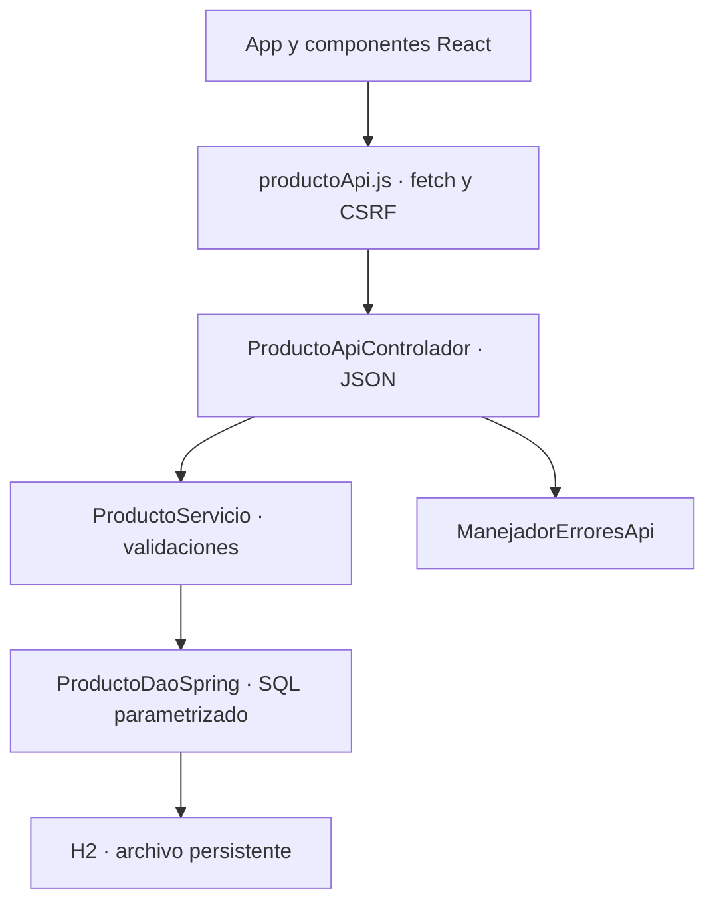
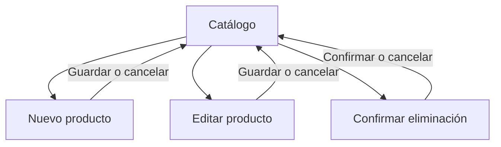

# Diseño y trazabilidad · GA7-220501096-AA4-EV03

## Objetivo y antecedentes

Codificar el front-end del catálogo de RaízVolt con React, manteniendo las
historias, los datos y las pantallas definidos en las evidencias anteriores.

Se consultaron el instrumento AA4-EV03, el documento real de componentes
AA4-EV02 y, dentro de AA3-EV02, el diseño, las reglas del servicio, las clases,
la persistencia y las capturas. La referencia de código es el commit
`ff5b13e578ecf169a93b5cbd473a87aac5f3a65b`.

Se conserva la identidad verde, la navegación lateral, los indicadores,
el buscador, la tabla, el formulario reutilizable y la confirmación de eliminación.
Los cambios son JSX, estado React, navegación con hash y una API JSON. Se añade el
valor exacto del inventario al resumen, como establece AA4-EV02. No se atribuye
aprobación docente a los artefactos revisados.

## Historias y criterios de aceptación

Actor: operador local. Precondiciones: servidor iniciado, base disponible y navegador.

| Historia / caso | Criterio implementado | Archivos principales | Verificación |
| --- | --- | --- | --- |
| HU-PR01 / CU-01 · Registrar | Crear, normalizar código, detectar duplicados y conservar campos al fallar. | `FormularioProducto`, `CampoFormulario`, `SelectorCategoria`, `ProductoApiControlador.registrar`. | Entradas, HTTP 201/400/409 y formulario. |
| HU-PR02 / CU-02 · Consultar | Buscar por código o nombre, coincidencia parcial sin distinguir mayúsculas; vacío, sin resultados, carga y error; resumen filtrado. | `CatalogoProductos`, `BuscadorProductos`, `ResumenInventario`, `TablaProductos`, `EstadoListado`. | Búsquedas, comodines literales, totales y estados. |
| HU-PR03 / CU-03 · Actualizar | Precargar, conservar ID, validar cambios y no alterar el registro si falla. | `FormularioProducto`, `productoApi.actualizar`, `ProductoApiControlador.actualizar`. | GET y PUT sobre el mismo ID; conflictos y entradas inválidas. |
| HU-PR04 / CU-04 · Eliminar | Identificar, cancelar sin modificar y borrar al confirmar. | `ConfirmarEliminacion`, `productoApi.eliminar`, `ProductoApiControlador.eliminar`. | GET no borra, DELETE exige CSRF; cancelar/confirmar. |

Poscondición: la lista refleja la base. Alternativas: error de campo, duplicado,
producto inexistente, CSRF caducado, fallo de conexión o base no disponible.
Las escrituras ocurren únicamente en eventos del usuario, nunca en efectos de montaje.

## Los 15 componentes de AA4-EV02

| Componente | Implementación |
| --- | --- |
| `App` | Estado compartido, navegación, consultas cancelables y escrituras. |
| `Encabezado` | Marca y navegación accesible. |
| `CatalogoProductos` | Composición de búsqueda, indicadores y tabla. |
| `BuscadorProductos` | Entrada controlada, Enter y limpieza. |
| `ResumenInventario` | Referencias, unidades, stock bajo y valor actual. |
| `TablaProductos` | Encabezados accesibles y filas con claves estables. |
| `FilaProducto` | Una referencia y sus acciones. |
| `IndicadorStock` | Cantidad y aviso textual con menos de cinco unidades. |
| `FormularioProducto` | Alta/edición y foco en el primer error. |
| `CampoFormulario` | Etiqueta, entrada, ayuda y error asociado. |
| `SelectorCategoria` | Cinco categorías del modelo. |
| `Boton` | Tipo, variantes y bloqueo durante operaciones. |
| `ConfirmarEliminacion` | Revisión y confirmación explícita. |
| `MensajeEstado` | Resultados con `status` o `alert`. |
| `EstadoListado` | Carga, vacío, sin coincidencias, error y recuperación. |

`useState`, `useEffect` y `useRef` son hooks, no componentes visuales.
Las props no se modifican directamente.

## Arquitectura y clases

`Producto`, `Categoria`, `ProductoDao`, `ProductoDaoSpring` y `ProductoServicio`
se conservan. El controlador adapta JSON al servicio; no se reescribe la
persistencia. `FormularioProducto` se reutiliza como DTO; el ID se recibe desde
la ruta. Los importes se calculan con `BigDecimal` y se devuelven como texto decimal.

## Navegación

Las rutas hash funcionan al recargar y con Atrás/Adelante. Cancelar conserva el
filtro anterior. Guardar abre el catálogo completo para mostrar la referencia
modificada. Una ruta desconocida ofrece volver; un ID inexistente no crea registros.

## Reglas

| Campo | Regla |
| --- | --- |
| ID | Generado por la base, positivo, no editable. |
| Código | 3–30 caracteres A–Z, 0–9 o guion; espacios externos eliminados; mayúsculas y único. |
| Nombre | 3–120 caracteres tras quitar espacios externos; tildes y ñ; sin controles ni saltos. |
| Categoría | `PANEL_SOLAR`, `INVERSOR`, `BATERIA`, `KIT_SOLAR`, `ACCESORIO`. |
| Precio | Mayor que 0, hasta 9999999999.99, máximo dos decimales; coma o punto sin miles. |
| Existencias | Entero de 0 a 1000000; alerta si es menor que cinco. |

No hay fechas en este módulo. La API, el servicio y SQL vuelven a validar antes
de guardar. La interfaz orienta al usuario y conserva sus datos al rechazar el envío.

## Accesibilidad y errores

- Etiquetas visibles, `htmlFor`, `aria-describedby`, `aria-invalid` y foco visible.
- Enlace para saltar al contenido, botones nativos y tabla con encabezados.
- Formulario de una columna en móvil; desplazamiento interno para la tabla.
- El color se acompaña de texto.
- `AbortController` descarta consultas obsoletas; se bloquea el doble envío.
- Si una escritura se confirma pero falla la consulta, se indica que ya quedó
  guardada. Una escritura con fallo de conexión no se reintenta automáticamente.

## Plan técnico aplicado

1. Revisar fuentes y conservar reglas e identidad.
2. Codificar componentes funcionales y CSS adaptable.
3. Añadir API JSON preservando servicio, DAO, H2 y CSRF.
4. Verificar validación, integración, navegación y compilación.
5. Documentar, versionar una rama independiente y empaquetar.

## Lista de chequeo

| Indicador del instrumento | Evidencia |
| --- | --- |
| Diseño conforme a prototipos. | Misma estructura, marca y pantallas; 15 componentes trazados. |
| Archivos y repositorio. | Código React/Java, scripts, dependencias declaradas, ejecutable, documentación y enlace. |
| Navegación funcional. | Catálogo, alta, edición, confirmación, búsqueda y rutas recuperables. |
| Requisitos iniciales. | HU-PR01 a HU-PR04, validaciones, persistencia y pruebas. |
