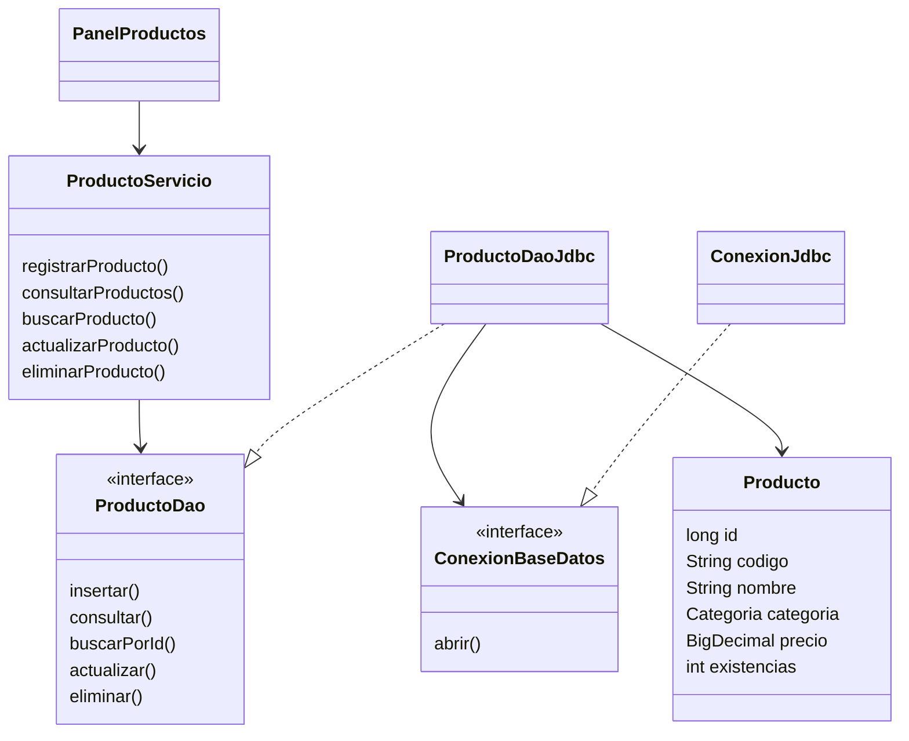

# Diseño y trazabilidad · RaízVolt

## Alcance y antecedentes

Se aplica la decisión del aprendiz de usar su negocio solar RaízVolt cuando
la evidencia requiera construir software. El catálogo permite administrar
paneles, inversores, baterías, kits y accesorios. El usuario funcional es el
operador del catálogo; la aplicación académica no incorpora un inicio de sesión.

Se revisaron estos antecedentes disponibles:

1. GA7-220501096-AA1-EV01_Informe_Tecnico_Jhon_Tineo.pdf (21/10/2026): herramientas,
   Git, separación de responsabilidades y plan de construcción.
2. GA7-220501096-AA1-EV02_Estandares_Codificacion_Jhon_Tineo.docx (22/10/2026):
   nombres, UTF-8, sangría, comentarios y revisión del código.
3. IE-GA7-220501096-AA2-EV01(1).pdf: conexión JDBC, CRUD, versionamiento y estándar.

Los diagramas e historias específicos de este módulo no venían adjuntos. Los
siguientes artefactos documentan el diseño de esta implementación; no se
presentan como versiones previas aprobadas. Deben cotejarse con cualquier
artefacto adicional que solicite el instructor.

## Historias, casos de uso y aceptación

| Historia / caso | Necesidad del operador | Criterio de aceptación | Implementación |
| --- | --- | --- | --- |
| HU-PR01 / CU-01 Registrar | Incorporar un producto solar | Con código único, nombre, categoría, precio positivo y stock válido, se guarda y aparece en la tabla. Los datos inválidos se rechazan. | registrarProducto / insertar |
| HU-PR02 / CU-02 Consultar | Encontrar productos | La búsqueda por fragmento de código o nombre presenta coincidencias; Mostrar todo recupera el catálogo; sin coincidencias se informa una tabla vacía. | consultarProductos / consultar |
| HU-PR03 / CU-03 Actualizar | Corregir datos o existencias | La fila seleccionada llena el formulario; Actualizar conserva su ID y guarda los nuevos valores válidos. | actualizarProducto / actualizar |
| HU-PR04 / CU-04 Eliminar | Retirar un producto del catálogo | Se selecciona una fila y se solicita confirmación. Cancelar conserva el registro; Eliminar lo borra. | eliminarProducto / eliminar |

Precondición común: aplicación iniciada y base accesible. Poscondición: la tabla
refleja el estado persistido. Los errores de conexión y códigos repetidos se
informan sin presentar un éxito falso. Cada operación modifica una sola fila.

## Clases y dependencias

## Diccionario de datos

| Campo | Tipo SQL | Restricción / uso |
| --- | --- | --- |
| id | BIGINT | Clave primaria autogenerada; no editable |
| codigo | VARCHAR(30) | Obligatorio, único; servicio normaliza a mayúsculas; 3-30 letras, números o guiones |
| nombre | VARCHAR(120) | Obligatorio; 3-120 caracteres validados por el servicio |
| categoria | VARCHAR(20) | PANEL_SOLAR, INVERSOR, BATERIA, KIT_SOLAR, ACCESORIO |
| precio | DECIMAL(12,2) | Mayor que cero; máximo 9999999999.99, moneda COP |
| existencias | INT | Entre 0 y 1000000, inclusivos |

Una tabla representa el alcance de este módulo. No se simulan relaciones con
ventas o proveedores que todavía no están implementados.

## Interfaz y navegación

Pantalla única: cabecera RaízVolt, formulario a la izquierda, búsqueda y tabla a
la derecha, mensajes de estado abajo. Registrar crea un producto. Seleccionar
una fila activa Actualizar y Eliminar. Nuevo / limpiar regresa al registro.
Se asocian etiquetas con campos; los botones mantienen foco visible; ordenar
la tabla conserva la identidad del registro seleccionado.

## Correspondencia con el instrumento de evaluación

| Criterio | Evidencia concreta |
| --- | --- |
| Conexión JDBC | ConexionJdbc usa DriverManager.getConnection; controladores en lib |
| Aplicación de CRUD | INSERT, SELECT, UPDATE y DELETE en ProductoDaoJdbc; eventos en PanelProductos |
| Herramientas de versionamiento | Historial Git y rama evidencia/aa2-ev01-raizvolt; enlace directo en ENLACE_REPOSITORIO.txt |
| Estándar definido | ESTANDAR_CODIFICACION.md, .editorconfig y código organizado por paquetes |

## Plan aplicado

1. Revisar criterios, alcance y estándares previos.
2. Crear repositorio y estructura de paquetes; registrar primer commit.
3. Implementar esquema, conexión, DAO y validaciones.
4. Construir interfaz; probar operaciones y persistencia.
5. Documentar resultados, publicar la rama de la evidencia y generar el ZIP
   desde la versión remota verificada.
