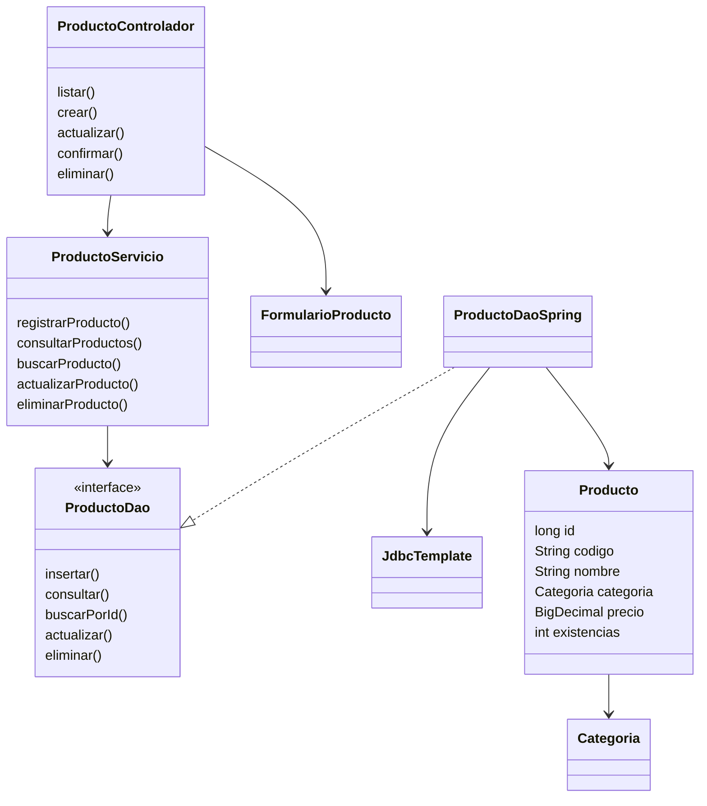
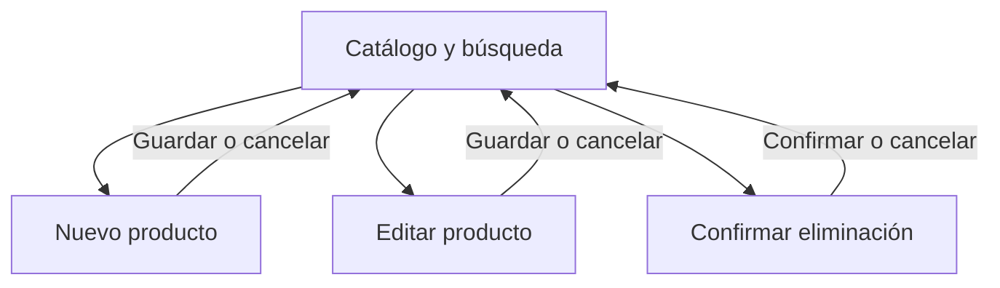

# Diseño, antecedentes y trazabilidad

## Introducción y objetivo

RaízVolt es la idea de negocio del aprendiz para comercializar soluciones solares
en Colombia. Esta evidencia implementa su módulo de productos como una aplicación
web con un framework, almacenamiento persistente, comentarios y estándares de
codificación, conservando los artefactos disponibles del módulo anterior.

El objetivo es aplicar Spring Boot al catálogo existente y comprobar que las
operaciones CRUD cumplen las historias de usuario y las reglas de datos.

## Artefactos consultados

Se leyó el instrumento `IE-GA7-220501096-AA3-EV01 (1).pdf` aportado en la actividad.
Se revisaron los siguientes archivos reales de `raizvolt-web` en la rama
`evidencia/aa2-ev02-raizvolt-web`, commit
`e2abeade7eca0afa4719b81058fec204481fce3c`:

- `docs/DISENO_Y_TRAZABILIDAD.md`: historias HU-PR01 a HU-PR04, casos de uso,
  clases, navegación, reglas, diseño de pantallas y plan de implementación.
- `docs/ESTANDAR_CODIFICACION.md`: nombres, sangría, comentarios y responsabilidades.
- `modelo/Producto.java`, `modelo/Categoria.java`, `dao/ProductoDao.java` y
  `servicio/ProductoServicio.java`, bajo `src/main/java/co/raizvolt`.
- `src/main/resources/sql/esquema.sql` y `src/main/webapp/assets`.

Son los artefactos disponibles en el código anterior. No se atribuye aprobación
docente a esos diseños ni se afirma haber revisado otros documentos no disponibles.
El diseño gráfico se conserva y sus vistas se reconstruyen con Thymeleaf.

## Framework y arquitectura aplicada

Se selecciona **Spring Boot 4.0.9** para mantener Java 17 y la arquitectura por capas
de AA2. El instrumento de evaluación no fija una marca de framework.

| Componente | Uso concreto en el módulo |
| --- | --- |
| Spring Boot | Arranque, configuración, gestión de dependencias y Tomcat integrado. |
| Spring MVC | `@Controller`, `@GetMapping`, `@PostMapping`, parámetros, modelo y vistas. |
| Inyección de dependencias | Spring crea el DAO y entrega sus dependencias por constructor. `@Bean` integra el servicio existente. |
| Spring JDBC | `JdbcTemplate` ejecuta SQL parametrizado y administra recursos JDBC. |
| Thymeleaf | Formularios, iteraciones, condicionales, fragmentos y escape de texto. |
| Spring Security | Token CSRF y cabeceras HTTP. No se implementa inicio de sesión. |
| H2 | Base SQL en archivo con clave primaria, código único y restricciones. |

## Continuidad de clases

`Producto`, `Categoria`, `ProductoDao` y `ProductoServicio` conservan el contrato de
AA2-EV02. `ProductoControlador` reemplaza el servlet escrito a mano; Spring gestiona
el despacho de solicitudes. `ProductoDaoSpring` reemplaza la apertura manual de
conexiones con `JdbcTemplate`. Las JSP se sustituyen por plantillas Thymeleaf.
El modelo es inmutable y las peticiones no comparten valores de formulario.

## Historias y casos de uso

Actor: operador local del catálogo. Precondición: aplicación iniciada y base disponible.

| Historia / caso | Necesidad y aceptación | Código / vista | Verificación |
| --- | --- | --- | --- |
| HU-PR01 / CU-01 | Registrar un producto válido con código único. Si falla, conservar los campos y explicar el error. | `crear`, `guardar`, `formulario.html`, `insertar` | Crear, normalizar, detectar duplicado y datos inválidos. |
| HU-PR02 / CU-02 | Consultar por nombre o código y mostrar un estado sin coincidencias. | `listar`, `productos.html`, `consultar` | Búsqueda parcial y literal, lista vacía e indicadores. |
| HU-PR03 / CU-03 | Precargar y actualizar sin cambiar el ID. | `editar`, `actualizar`, `formulario.html` | Cambiar precio/stock y rechazar duplicado sin alterar la fila. |
| HU-PR04 / CU-04 | Confirmar antes de eliminar. Cancelar conserva el registro. | `confirmar`, `eliminar`, `confirmar.html` | GET no borra; POST válido elimina una sola referencia. |

Poscondición: la lista refleja el estado guardado. Casos alternativos: datos
incorrectos, código duplicado, ID inexistente, token CSRF inválido o base no disponible.
Se usan respuestas 400, 409, 404, 403 y 503 respectivamente; una escritura correcta
redirige con 303 para evitar repetición al recargar la página.

## Navegación y pantallas

Se conserva el diseño de AA2: verde de marca, fondo neutro, encabezados, tres
indicadores, búsqueda y tabla. Los formularios tienen etiquetas, ayudas y mensajes.
La navegación funciona sin JavaScript. El foco es visible, hay enlace para saltar
al contenido y el formulario se adapta a una columna en móvil. La tabla utiliza
desplazamiento horizontal dentro de su propio contenedor.

## Diccionario y reglas conservadas

| Campo | Almacenamiento | Regla del servicio |
| --- | --- | --- |
| id | BIGINT, clave primaria generada | No editable, positivo. |
| codigo | VARCHAR(30), NOT NULL, UNIQUE | 3 a 30 letras, números o guiones; normalizado a mayúsculas. |
| nombre | VARCHAR(120), NOT NULL | 3 a 120 caracteres, sin controles ni saltos de línea. |
| categoria | VARCHAR(20), NOT NULL, CHECK | PANEL_SOLAR, INVERSOR, BATERIA, KIT_SOLAR o ACCESORIO. |
| precio | DECIMAL(12,2), NOT NULL, CHECK > 0 | Máximo 9999999999.99 COP; punto o coma decimal, sin miles. |
| existencias | INT, NOT NULL, CHECK | Entero entre 0 y 1000000. |

No se cargan productos automáticamente. El esquema usa `CREATE TABLE IF NOT EXISTS`,
por lo que no borra registros al reiniciar. El aviso de stock bajo usa el umbral
heredado de menos de cinco unidades.

## Rutas

Todas parten del contexto `/raizvolt`.

| Método | Ruta | Resultado |
| --- | --- | --- |
| GET | `/productos?q=texto` | Catálogo o búsqueda. |
| GET | `/productos/nuevo` | Formulario vacío. |
| POST | `/productos` | Crear. |
| GET | `/productos/{id}/editar` | Formulario precargado. |
| POST | `/productos/{id}` | Actualizar. |
| GET | `/productos/{id}/eliminar` | Confirmar sin borrar. |
| POST | `/productos/{id}/eliminar` | Eliminar. |

## Plan de trabajo aplicado

1. Revisar el instrumento y los artefactos de AA2-EV02.
2. Conservar dominio, historias y reglas; seleccionar Spring Boot para la evolución web.
3. Implementar controlador MVC, plantilla JDBC, configuración y vistas Thymeleaf.
4. Verificar CRUD, validaciones, persistencia y funcionamiento del JAR.
5. Revisar interfaz en escritorio y móvil; documentar instrucciones y resultados.
6. Versionar en una rama propia y preparar el ZIP con el enlace al repositorio.

## Correspondencia con la lista de chequeo

| Indicador del instrumento | Evidencia en esta entrega |
| --- | --- |
| Selecciona y aplica un framework | `pom.xml`, clase de arranque, controlador MVC y DAO Spring. |
| Integra almacenamiento de datos | H2 en archivo, `schema.sql`, `ProductoDaoSpring`, pruebas de persistencia. |
| Estándar y comentarios | Comentarios Java/HTML/SQL/configuración; `ESTANDAR_CODIFICACION.md`. |
| Utiliza un estándar definido | Paquetes por capas, convenciones, `.editorconfig` y `.gitattributes`. |
| Versionamiento y entrega solicitados | Rama Git, historial, archivo con enlace y ZIP identificado. |
