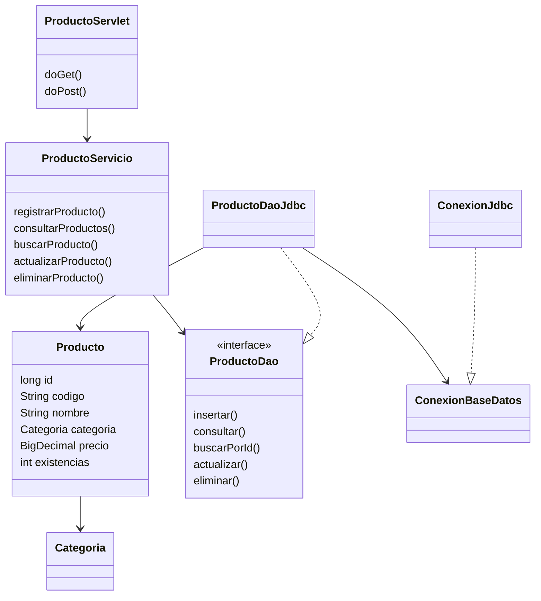
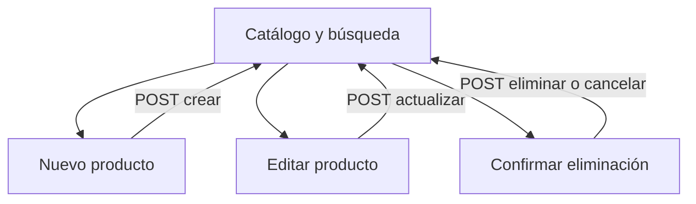

# Diseño y trazabilidad de EV02

## Antecedente verificado

Se revisó el proyecto `raizvolt-jdbc` de la rama `evidencia/aa2-ev01-raizvolt`, commit
`d8809197cdd24c0a5860960c83edf1e49ee7c917`, y su documento
`docs/DISENO_Y_TRAZABILIDAD.md`. Se conserva la entidad Producto con código, nombre,
categoría, precio y existencias; las historias HU-PR01 a HU-PR04; el esquema SQL;
las reglas de negocio y el patrón DAO con JDBC. El diseño de interfaz Swing de EV01
se adapta ahora a vistas JSP y un controlador Servlet. Estos son artefactos de
implementación del módulo, no versiones que se atribuyan a una aprobación docente.

Se revisó `IE-GA7-220501096-AA2-EV02.pdf`, instrumento aportado en esta actividad.
La empresa elegida sigue siendo RaízVolt, según la decisión del aprendiz de aplicar
su idea de comercialización de soluciones solares en las evidencias de software.

## Introducción y objetivo

El módulo transforma el catálogo local en una aplicación web que separa vista,
controlador, reglas de negocio y persistencia. El objetivo es codificar y probar
formularios HTML conectados a servlets, usar GET y POST para recibir parámetros y
presentar contenido dinámico con JSP, manteniendo el versionamiento del código.

## Historias y casos de uso

| Historia / caso | Necesidad | Criterio observable | Implementación web |
| --- | --- | --- | --- |
| HU-PR01 / CU-01 Registrar | Agregar un producto solar | Formulario válido guarda un código único y redirige al listado. Datos inválidos conservan el formulario con mensaje. | GET nuevo, POST crear, formulario.jsp |
| HU-PR02 / CU-02 Consultar | Encontrar un producto | Buscar por nombre o código muestra coincidencias; una consulta sin resultados presenta un estado vacío. | GET buscar, parámetro q, productos.jsp |
| HU-PR03 / CU-03 Actualizar | Corregir precio, nombre o stock | Editar precarga datos por ID; guardar conserva el ID y actualiza una fila. | GET editar, POST actualizar |
| HU-PR04 / CU-04 Eliminar | Retirar una referencia | GET muestra confirmación; cancelar conserva el producto; confirmar envía POST y elimina una fila. | GET confirmar, POST eliminar, confirmar.jsp |

Actor: operador del catálogo. Precondición: aplicación iniciada y base disponible.
Poscondición: el listado corresponde al estado persistido. Los fallos no muestran
mensajes de éxito. Casos alternativos: código repetido, campos incorrectos,
identificador inexistente, token vencido y base inaccesible.

## Clases

`InicioAplicacion` construye las dependencias al iniciar. `FiltroWeb` establece
UTF-8 y cabeceras antes de leer parámetros. Las JSP reciben atributos del servlet,
no ejecutan SQL. `Servlet` no comparte valores de formularios entre peticiones.

## Navegación y diseño de pantallas

- Catálogo: cabecera de marca, tres indicadores, buscador, tabla y acciones.
- Nuevo/editar: campos con etiquetas y ayudas, categoría desplegable, cancelar y guardar.
- Confirmación: identidad y datos del producto; decisión explícita antes de eliminar.
- Error: mensaje legible y regreso al catálogo.

Predominan verde, neutros claros y texto oscuro. Foco visible, enlace para saltar al
contenido, etiquetas asociadas, mensajes con roles y tabla con encabezados. En móvil
el formulario usa una columna; la tabla tiene desplazamiento horizontal interno.

## Datos y reglas heredadas

| Campo | Tipo / regla |
| --- | --- |
| id | BIGINT, clave primaria automática, no editable. |
| codigo | VARCHAR(30), único, 3-30 letras/números/guiones, normalizado a mayúsculas. |
| nombre | VARCHAR(120), de 3 a 120 caracteres, una sola línea. |
| categoria | PANEL_SOLAR, INVERSOR, BATERIA, KIT_SOLAR o ACCESORIO. |
| precio | DECIMAL(12,2), mayor que 0, máximo 9999999999.99 COP. |
| existencias | INT de 0 a 1000000. |

El precio usa BigDecimal para conservar los decimales. El servicio acepta punto o
coma decimal, sin separadores de miles. Los indicadores resumen la lista filtrada.
El aviso de stock bajo no es una restricción para guardar.

## Métodos HTTP y parámetros

Todas las rutas de esta tabla parten de `/raizvolt/productos`.

| Método | accion | Parámetros adicionales | Resultado |
| --- | --- | --- | --- |
| GET | listar o ausente | Ninguno | Catálogo. |
| GET | buscar | q | Coincidencias por código o nombre. |
| GET | nuevo | Ninguno | Formulario vacío. |
| GET | editar | id | Formulario precargado. |
| GET | confirmar | id | Confirmación sin borrar datos. |
| POST | crear | codigo, nombre, categoria, precio, existencias, csrf | Inserción y 303 al catálogo. |
| POST | actualizar | id y campos del producto, csrf | Actualización y 303. |
| POST | eliminar | id, csrf | Eliminación y 303. |

GET no inserta, actualiza ni elimina. `request.getParameter` recibe los campos y
`request.setAttribute` entrega datos a las vistas. Respuestas: 400 datos inválidos,
403 token inválido, 404 producto no encontrado en GET, 409 código duplicado,
503 fallo de persistencia y 303 tras una escritura correcta.

## Elementos JSP

- Directiva `page`: tipo de respuesta y codificación UTF-8.
- Directiva `taglib`: JSTL `jakarta.tags.core` y `jakarta.tags.fmt`.
- Directiva `include`: cabecera y pie comunes.
- Expresiones EL: atributos de petición y de sesión.
- `c:forEach`: filas y categorías; `c:if` / `c:choose`: estados y mensajes.
- `c:out`: escape de nombres, códigos, consultas y errores.
- `c:url` / `c:param`: enlaces con contexto y parámetros.
- `fmt:formatNumber`: presentación de precios y cantidades.
- `jsp:forward`: entrada `index.jsp` delega en el servlet.

## Criterios de la guía

| Indicador | Evidencia verificable |
| --- | --- |
| Formularios HTML con servlets | productos.jsp, formulario.jsp y confirmar.jsp; mapeo /productos en web.xml. |
| GET y POST para parámetros | ProductoServlet.doGet/doPost y pruebas HTTP. |
| Elementos JSP | Cuatro vistas JSP, fragmentos comunes, EL, JSTL y acción jsp:forward. |
| Herramientas de versionamiento | Git, rama EV02, historial local y enlace remoto. |

## Plan aplicado

Revisar EV01 y el instrumento; reutilizar dominio/JDBC; agregar servlet y JSP;
compilar; verificar CRUD, parámetros y persistencia; revisar interfaz; documentar;
publicar la rama específica y generar el ZIP con nombre de aprendiz y evidencia.
